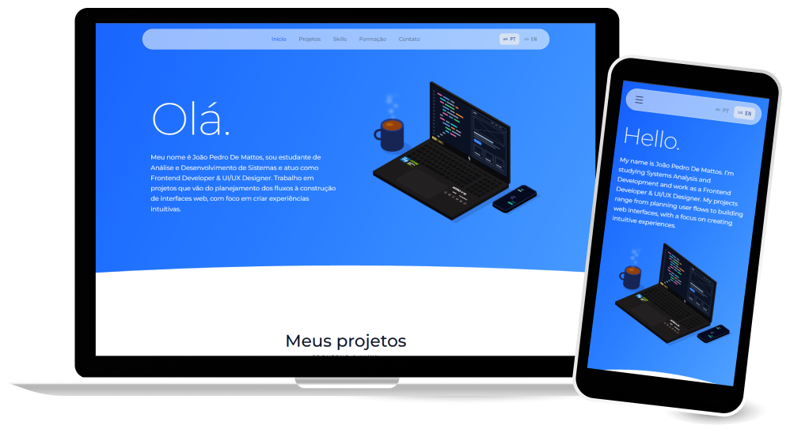

# João Pedro de Mattos — Portfolio

Personal portfolio showcasing my frontend development and UI/UX projects.

[](https://jpmattos.vercel.app/)
[](https://github.com/joaomattos07/portfolio)



## ✨ About

This portfolio was built to present my projects, skills, and education in one place. It is available in Portuguese and English, adapts to mobile and desktop screens, and includes dedicated pages for each project.

## 🚀 Features

- Responsive layout for mobile, tablet, and desktop
- Portuguese and English language support
- Project list with dedicated detail pages
- Page transitions when opening and leaving a project
- Reduced-motion support
- Contact links and downloadable résumé

## 🛠️ Technologies

<p align="left">
  
</p>

- **Frontend:** React, JavaScript, HTML5, CSS3, Tailwind CSS
- **Routing:** React Router
- **Build tool:** Vite
- **Design:** Figma and FigJam

## 📁 Project Structure

```text
portfolio/
├── public/
│   ├── CV-Joao-Pedro-De-Mattos.pdf
│   └── projects/       # Project images and assets
└── src/
    ├── components/     # Reusable interface components
    ├── data/           # Project and contact information
    ├── i18n/           # Portuguese and English translations
    ├── pages/          # Home and project detail pages
    ├── App.jsx
    └── index.css
```

## 💻 Run Locally

1. Clone the repository:

   ```bash
   git clone https://github.com/joaomattos07/portfolio.git
   ```

2. Open the project folder and install dependencies:

   ```bash
   cd portfolio
   npm install
   ```

3. Start the development server:

   ```bash
   npm run dev
   ```

To create a production build, run:

```bash
npm run build
```

## 👨‍💻 Author

Developed by **João Pedro de Mattos**.

## 🌐 Contact

[](https://www.linkedin.com/in/joaopedrodemattos)
[](mailto:joaopedro261206@gmail.com)
